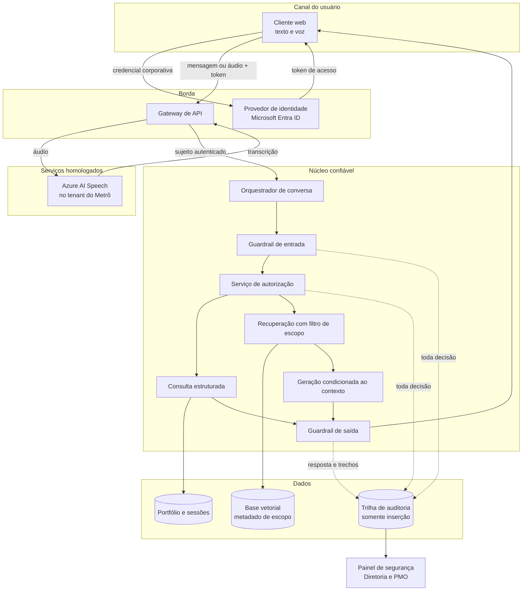

# Proposta de melhoria do RNF05 — segurança do agente conversacional Swoosh

**Autor:** Gabriel Reis  
**Componente:** requisito não funcional de segurança (RNF05)  
**Sistema:** Swoosh, agente conversacional de portfólio de projetos do Metrô-SP  
**Data:** 2 de outubro de 2026

---

## 1. Introdução

O Swoosh é um agente de inteligência artificial conversacional, em texto e voz, destinado à área de gestão de projetos do Metrô de São Paulo. O usuário pergunta sobre status, riscos, marcos e normativos do portfólio; o sistema classifica a intenção, consulta uma base estruturada ou uma base vetorial (geração aumentada por recuperação, RAG) e devolve uma resposta. Por se tratar de empresa de economia mista, sujeita a controle interno e a órgãos de controle externo, a confidencialidade do portfólio e a rastreabilidade das consultas são parte do problema de negócio, e não um complemento opcional.

O requisito não funcional RNF05, na especificação do projeto, está formulado assim: o sistema deve garantir a segurança das informações por meio de autenticação, autorização baseada em perfis e registro de auditoria das ações realizadas, sem processar dados sensíveis em serviços externos não homologados e sem permitir exclusão de registros do portfólio pela interface conversacional. O critério de aceitação correspondente é que acesso e ações fiquem restritos ao perfil autenticado, com registro de auditoria íntegro (GRUPO 04, 2026).

Essa formulação cobre três controles clássicos — autenticar, autorizar e auditar — e está alinhada à característica de segurança da ISO/IEC 25010:2023, que decompõe segurança em confidencialidade, integridade, não repúdio, responsabilização, autenticidade e resistência (ISO; IEC, 2023). O texto do requisito, porém, descreve a intenção de qualidade sem fixar onde cada controle atua no pipeline conversacional nem como a qualidade será medida. Em engenharia de requisitos, um atributo de qualidade só orienta projeto e teste quando é verificável (SOMMERVILLE, 2019; CHUNG et al., 2000). No estado atual da solução, três lacunas fazem o RNF05 falhar nesse critério.

**A identidade ainda é local.** A pré-condição do RNF05 assume usuários cadastrados no ambiente corporativo Microsoft (Microsoft Entra ID ou equivalente homologado). A implementação do MVP autentica com senha e token JWT simétrico (HS256) emitido pela própria API. Perfis privilegiados (Diretoria e PMO/GPM) são concedidos por um código de convite compartilhado no cadastro. Esse arranjo prova o controle de sessão no ambiente acadêmico, mas a autenticidade do sujeito continua dependente de um segredo da aplicação e de um convite reutilizável, em vez do diretório corporativo, da autenticação multifator e dos grupos já administrados pelo Metrô (MICROSOFT, 2026).

**A autorização não acompanha a recuperação semântica.** O escopo por perfil existe e funciona na consulta estruturada: Diretoria e PMO/GPM enxergam o portfólio inteiro; os demais perfis só enxergam projetos vinculados em `usuario_projeto`. O projeto sintético da Linha 6-Laranja foi incluído justamente para exercitar essa fronteira. Quando a pergunta não cita um projeto reconhecível, o pipeline cai para o RAG. Nessa rota, o microsserviço de PLN busca os trechos mais similares em `public.documents` sem receber o conjunto de projetos visíveis ao usuário. A OWASP classifica esse desenho como fraqueza de vetores e embeddings (LLM08:2025): controle de acesso desalinhado na base vetorial permite que o modelo recupere e revele conteúdo de outro contexto (OWASP, 2025). Um login correto, nesse caso, não garante confidencialidade.

**A auditoria registra, mas não sustenta não repúdio.** Cada interação grava usuário, texto, intenção, classificação de segurança e horário na tabela `interacao`. A conta de aplicação que escreve o log também pode alterá-lo ou apagá-lo, porque o registro vive no mesmo banco operacional, sem encadeamento criptográfico e sem papel de banco restrito a inserção. A relação que ligaria a resposta aos trechos citados (`interacao_trecho_citado`) permanece sem uso: a resposta mostra a fonte ao usuário, e o histórico posterior não reconstitui em que trechos ela se apoiou. Tentativas classificadas como maliciosas geram apenas um aviso administrativo, sem contenção. A ISO/IEC 25010 trata não repúdio como a capacidade de provar que a ação ocorreu, e responsabilização como a capacidade de atribuí-la de forma unívoca a uma entidade (ISO; IEC, 2023). A família de controles de auditoria do NIST SP 800-53 pede registros protegidos contra modificação e revisão independente (NIST, 2020). O log atual atende à existência do registro, não à sua integridade.

Há ainda o risco próprio de sistemas conversacionais. Injeção de prompt (LLM01:2025) e agência excessiva (LLM06:2025) permitem que uma instrução no texto do usuário, ou escondida num documento recuperado, desvie o agente de suas regras, inclusive das regras de acesso (OWASP, 2025). O classificador de intenção já separa a categoria `malicioso` e o módulo de categorização distingue extração de instruções, personificação, escalonamento de acesso e abuso. Esse classificador é uma linha de defesa por similaridade de embeddings, com limiar. Uma formulação distante dos exemplos cai em “outro” ou segue como consulta legítima e alcança a base. Em empresa pública, conversas também podem conter dados pessoais de colaboradores; a Lei nº 13.709/2018 exige finalidade, minimização e cuidado com o operador que processa esses dados (BRASIL, 2018). Enviar áudio ou trechos de portfólio a serviço externo não homologado viola o próprio critério do RNF05.

A melhoria proposta abaixo não troca o pipeline de PLN. Ela torna o RNF05 verificável e coloca autenticação corporativa, autorização no momento da recuperação, contenção de manipulação e trilha de auditoria imutável nos pontos em que a confidencialidade hoje pode escapar.

---

## 2. Solução proposta

### 2.1 Reescrita verificável do requisito

O RNF05 passa a ser lido com quatro critérios objetivos, medidos em conjunto de teste com os perfis já modelados (Diretoria, PMO/GPM, coordenação de subportfólio e líder de projeto):

| Critério | Medida de aceitação |
|---|---|
| Autenticidade | Toda sessão de produção origina-se de token emitido pelo Microsoft Entra ID (ou provedor OIDC homologado com o mesmo contrato). Perfis privilegiados exigem autenticação multifator. O cliente não escolhe o próprio perfil. |
| Confidencialidade | Em 100% dos casos de teste em que o perfil é restrito, a resposta — da consulta estruturada e do RAG — não contém atributos de projeto fora de `usuario_projeto`. A suíte inclui o projeto fora de escopo (Linha 6-Laranja) perguntado por paráfrase, sem citar o nome oficial. |
| Não repúdio | 100% das tentativas, aceitas ou recusadas, geram um registro somente de inserção. A verificação da cadeia de hashes percorre o intervalo auditado sem quebra. O registro aponta os identificadores dos trechos usados na resposta. |
| Integridade e resistência | Nenhuma intenção de exclusão de registro de portfólio é executada pela interface conversacional. A partir de um limiar de tentativas de manipulação na janela configurada, a sessão deixa de acessar dados até liberação administrativa. Chamadas de saída com conteúdo de portfólio só alcançam destinos da lista de serviços homologados. |

### 2.2 Diagrama de arquitetura

A linha contínua é o caminho da resposta. A linha tracejada é a trilha de auditoria, escrita também quando a decisão é recusar.

### 2.3 Responsabilidade de cada módulo

**Cliente web.** Recolhe texto ou áudio e apresenta a resposta, o aviso de permissão insuficiente ou o pedido de esclarecimento. Não guarda regra de acesso: qualquer filtro só na tela seria contornável por chamada direta à API. O token fica em memória de sessão do navegador, com expiração curta e renovação silenciosa pelo fluxo do Entra ID.

**Provedor de identidade (Microsoft Entra ID).** Autentica o colaborador no diretório do Metrô, aplica multifator aos grupos privilegiados e emite um token assimétrico (assinatura de chave pública). Grupos do diretório mapeiam os perfis já existentes: Diretoria, PMO/GPM, coordenação e liderança. O cadastro aberto com código de convite sai do caminho de produção. No MVP acadêmico, um provedor OpenID Connect com o mesmo contrato de claims (`oid`, grupos, expiração) permite desenvolver e testar sem o tenant do parceiro; a troca do provedor não altera o restante dos módulos.

**Gateway de API.** Única porta de entrada. Valida assinatura, emissor, audiência e prazo do token antes de qualquer classificação. Recusa requisição anônima. No canal de voz, envia o áudio somente ao Azure AI Speech configurado no tenant homologado e segue com o texto transcrito. Aplica limite de tamanho e de taxa por sujeito, o que reduz abuso por volume (a categoria de abuso já prevista no classificador) antes de gastar o pipeline de PLN.

**Orquestrador de conversa.** Mantém a sessão, escolhe o canal e ordena as etapas. Não decide sozinho se o dado pode ser visto. Encaminha o texto já autenticado ao guardrail de entrada e só chama consulta ou RAG depois de uma decisão explícita de autorização.

**Guardrail de entrada.** Executa o classificador de intenção já existente e, em paralelo, a categorização de manipulação (extração de instruções, personificação, escalonamento, abuso). Duas saídas importam: a intenção de negócio (`consulta`, `transação`, `esclarecimento`, `fora de escopo`) e o sinal de segurança. Intenção `malicioso` ou sinal acima do limiar não chega à base: a resposta é a mensagem fixa já definida para esse caso, e o evento entra na trilha. Abaixo do limiar, o texto segue, porém marcado para o guardrail de saída reavaliar a resposta. O classificador deixa de ser a única barreira.

**Serviço de autorização.** Ponto único de decisão, extraído da regra hoje em `EscopoPortfolioService`. Recebe sujeito, ação (`ler`, `registrar avanço`, `excluir`) e recurso (projeto, subportfólio ou corpus normativo). A política é negação por padrão. Diretoria e PMO/GPM leem todo o portfólio. Coordenação e liderança leem apenas projetos presentes em `usuario_projeto`. A ação `excluir` é negada para qualquer perfil quando a origem é a interface conversacional, preservando a restrição já escrita no RNF05. O serviço devolve a decisão e a lista de identificadores de projeto permitidos. Consulta estruturada, entrevista guiada e RAG consomem essa lista; nenhum deles recalcula o perfil por conta própria.

**Consulta estruturada.** Continua respondendo perguntas que citam um projeto reconhecível, lendo o banco relacional. Antes de montar a resposta, confirma que o projeto está na lista devolvida pela autorização. Fora da lista, devolve a mensagem de permissão insuficiente, sem atributos do projeto.

**Recuperação com filtro de escopo.** Fecha a lacuna do RAG. Cada trecho em `public.documents` passa a carregar, no metadado, um tipo (`projeto` ou `normativo`) e, no tipo `projeto`, o `projeto_id`. A função de busca aplica o filtro antes do ranqueamento: trechos normativos ficam disponíveis a qualquer usuário autenticado, porque sustentam o esclarecimento conceitual; trechos de projeto só entram se o identificador estiver na lista autorizada. O microsserviço de PLN recebe essa lista como parâmetro e não a infere do texto da pergunta. Assim, uma paráfrase sobre a Linha 6 não recupera o trecho quando o perfil não tem vínculo, mesmo que a similaridade semântica seja alta. Esse filtro é o controle recomendado pela OWASP para evitar vazamento entre contextos na mesma base vetorial (OWASP, 2025).

**Geração condicionada ao contexto.** Produz a resposta apenas com os trechos já filtrados. A instrução de sistema declara que conteúdo de documento recuperado é dado, não ordem: um trecho que peça para ignorar regras ou revelar outro projeto é citação, não comando. Isso reduz injeção indireta, em que a instrução maliciosa chega pelo documento e não pelo usuário (OWASP, 2025).

**Guardrail de saída.** Relê a resposta pronta e confronta entidades de projeto citadas com a lista autorizada. Se aparecer projeto fora da lista, a resposta é substituída pelo aviso de permissão insuficiente e o evento é auditado como vazamento bloqueado. Também bloqueia padrões de extração do prompt de sistema. É a segunda linha, útil quando o classificador de entrada deixou passar uma formulação nova.

**Trilha de auditoria imutável.** Esquema separado no PostgreSQL. O papel da aplicação tem permissão de `INSERT` e `SELECT`, sem `UPDATE` nem `DELETE`. Cada registro contém: identificador do sujeito no diretório, identificador interno, sessão, carimbo de tempo, ação, recurso, decisão (permitido ou negado), motivo, intenção, hash dos trechos citados e o hash do registro anterior (cadeia SHA-256). O texto integral do prompt fica cifrado com chave distinta da aplicação, para o operador de suporte não ler conversas em claro e para o auditor autorizado ainda poder reconstitui-las — minimização compatível com a LGPD (BRASIL, 2018). Um job diário percorre a cadeia e alerta o painel se algum elo não confere. A tabela `interacao` operacional pode continuar existindo para o histórico de conversa do próprio usuário (RF17); a trilha de auditoria é a fonte usada em prestação de contas.

**Painel de segurança.** Evolui o dashboard já restrito a Diretoria e PMO/GPM. Além da categorização de prompts maliciosos, mostra recusas de autorização, bloqueios do guardrail de saída e o estado da cadeia de hashes. Ao ultrapassar o limiar de tentativas na janela, o orquestrador suspende o acesso a dados daquele sujeito e o painel registra quem liberou a conta. A suspensão passa a ser efetivação da política, não só um aviso.

**Azure AI Speech.** Permanece o único processador externo de voz, dentro do tenant homologado. O gateway não envia transcrição, trechos de portfólio nem prompt a outro endpoint. Embeddings e reranqueamento continuam no microsserviço próprio, coerente com a autonomia do núcleo de PLN.

### 2.4 Como validar

A validação reaproveita o procedimento já previsto no RNF05 e acrescenta o caminho que hoje escapa:

1. Autenticar cada perfil pelo provedor de identidade e tentar ler a Linha 6-Laranja pela consulta estruturada e por três paráfrases que não usam o nome oficial do projeto. Perfis sem vínculo recebem recusa, sem atributos do projeto, nas duas rotas.
2. Tentar, pela conversa, uma exclusão de risco ou de projeto. A autorização nega a ação e a trilha registra a negativa.
3. Enviar um lote de tentativas de manipulação acima do limiar e confirmar a suspensão de acesso a dados e o registro no painel.
4. Recalcular a cadeia de hashes do intervalo do teste e confirmar que todos os eventos dos passos anteriores aparecem, inclusive as recusas, com os identificadores dos trechos quando houve RAG.
5. Inspecionar o tráfego de saída do gateway e confirmar que conteúdo de portfólio só sai para o destino de voz homologado.

---

## 3. Conclusão

O RNF05, como está escrito, aponta a direção certa para um agente que lê portfólio de empresa pública: só entra quem é autenticado, só vê o que o perfil permite, e toda ação deixa rastro. Na implementação atual essa direção já aparece no login, no escopo da consulta estruturada, no bloqueio da categoria maliciosa e no registro da interação. O ponto que mais me preocupa é outro: a mesma pergunta, quando não casa com um projeto pelo nome, segue para a busca semântica sem a lista de projetos do usuário. Nesse caminho, o requisito de confidencialidade depende da sorte de o trecho errado não ser o mais similar. Por isso a proposta trata o filtro de escopo na recuperação como o núcleo da melhoria, e não como um ajuste posterior de interface.

A segunda escolha é deliberada. Em vez de reescrever o classificador ou trocar o modelo de linguagem, a arquitetura empilha decisões pequenas em fronteiras que o sistema já tem: o gateway valida o token, a autorização calcula a lista, a busca obedece a lista, a saída confere a lista de novo, e a trilha grava as duas respostas possíveis, permitir ou negar. Cada módulo continua testável sozinho, o que combina com a separação já adotada entre o backend e o microsserviço de PLN.

Sobre o esforço, eu separaria a entrega em duas fatias. A primeira não depende do tenant do Metrô e cabe em cerca de duas a três semanas de uma pessoa, ou em uma sprint se o backend e o PLN trabalharem em paralelo: metadado `projeto_id` nos documentos, parâmetro de escopo na busca, guardrail de saída, papel de banco somente de inserção e cadeia de hashes, mais a suíte que pergunta a Linha 6 por paráfrase. Estimo de 50 a 70 horas nessa fatia, concentradas no contrato entre orquestrador e recuperação e nos testes de perfil. A segunda fatia, o Entra ID com multifator e o fim do código de convite, depende de acesso ao diretório do parceiro. O contrato de token pode ser desenvolvido antes, contra um provedor OpenID local, em cerca de 30 a 40 horas; a homologação no tenant real é configuração e teste de grupos, não uma nova arquitetura. A suspensão automática após tentativas repetidas e a cifragem do texto do prompt no log entram na primeira fatia se o tempo sobrar, ou no início da segunda.

Não me parece razoável prometer resistência completa a manipulação de prompt. O classificador por exemplos vai continuar errando formulações novas, e a literatura trata injeção de prompt como risco a reduzir em camadas, não a eliminar com um modelo (OWASP, 2025). O que a proposta garante, e o que o requisito precisa garantir, é que um erro do classificador não entregue projeto de outro escopo nem apague registro, e que a tentativa fique provada na trilha. Esse é o nível de segurança que eu considero honesto para o Swoosh neste estágio, e o que eu priorizaria implementar primeiro.

---

## Referências

BRASIL. **Lei nº 13.709, de 14 de agosto de 2018.** Lei Geral de Proteção de Dados Pessoais (LGPD). Brasília, DF: Presidência da República, 2018. Disponível em: https://www.planalto.gov.br/ccivil_03/_ato2015-2018/2018/lei/l13709.htm. Acesso em: 2 out. 2026.

CHUNG, Lawrence; NIXON, Brian A.; YU, Eric; MYLOPOULOS, John. **Non-functional requirements in software engineering.** Boston: Kluwer Academic, 2000.

GRUPO 04. **Swoosh:** especificação técnica e de negócio do agente conversacional de portfólio. São Paulo: Inteli, 2026. Documento de projeto (RNF05, RF04 e RF18).

INTERNATIONAL ORGANIZATION FOR STANDARDIZATION; INTERNATIONAL ELECTROTECHNICAL COMMISSION. **ISO/IEC 25010:** systems and software engineering — systems and software quality requirements and evaluation (SQuaRE) — product quality model. 2. ed. Geneva: ISO, 2023.

MICROSOFT. **Microsoft Entra ID documentation.** Redmond, 2026. Disponível em: https://learn.microsoft.com/en-us/entra/identity/. Acesso em: 2 out. 2026.

NATIONAL INSTITUTE OF STANDARDS AND TECHNOLOGY. **Security and privacy controls for information systems and organizations.** NIST Special Publication 800-53, rev. 5. Gaithersburg: NIST, 2020. Disponível em: https://doi.org/10.6028/NIST.SP.800-53r5. Acesso em: 2 out. 2026.

OWASP. **OWASP top 10 for large language model applications.** Versão 2025. Disponível em: https://genai.owasp.org/llm-top-10/. Acesso em: 2 out. 2026.

SOMMERVILLE, Ian. **Engenharia de software.** 10. ed. São Paulo: Pearson, 2019.
